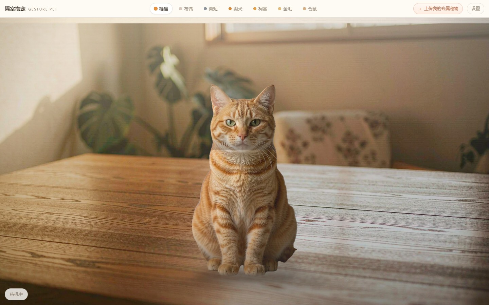
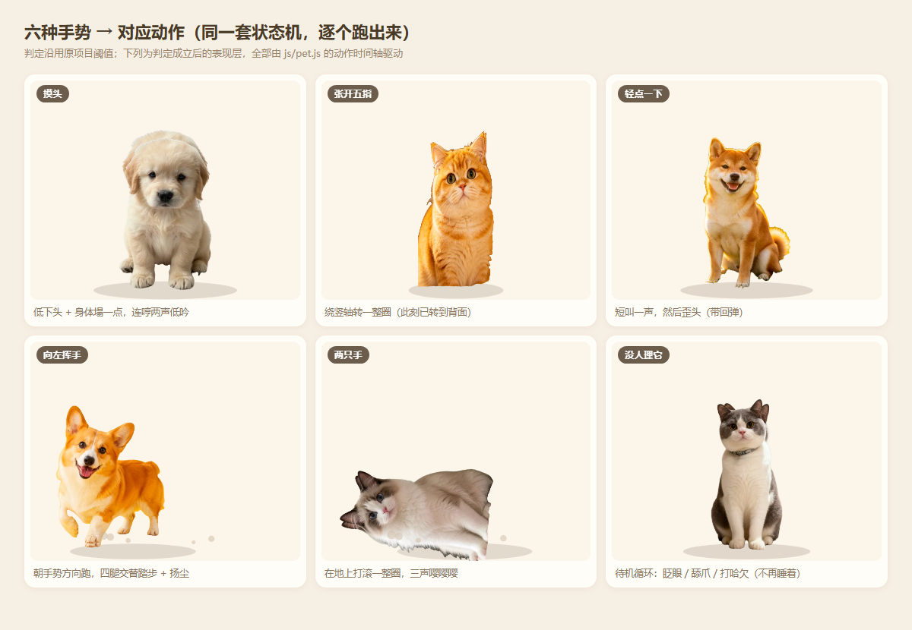
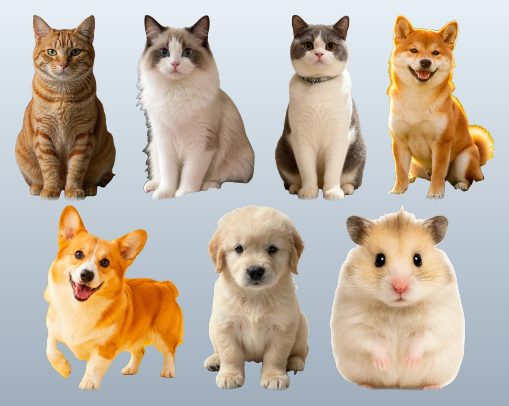
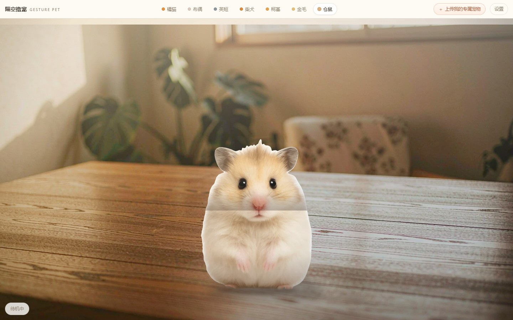
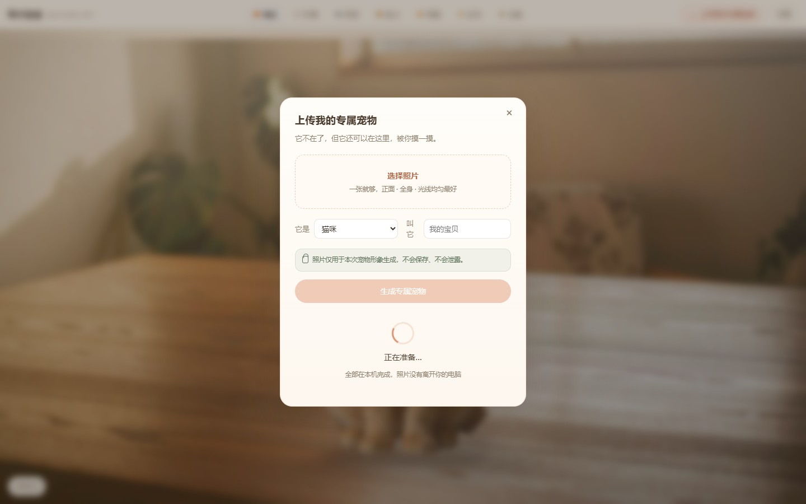
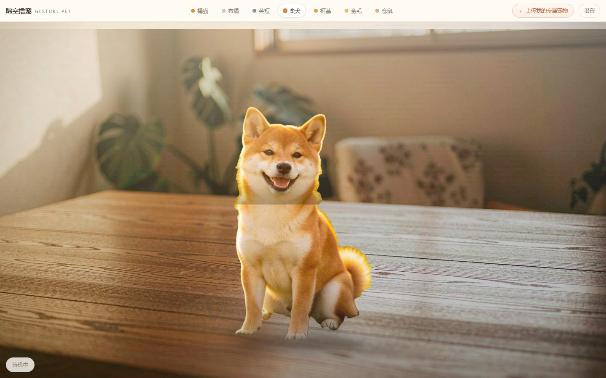

# 隔空撸宠 · Gesture Pet

对着摄像头伸手，隔空摸一只**实拍的**猫 —— 它站在你家的桌面上，光从同一扇窗照进来。

手放在它头上，它会低下头、舒服地塌一点，轻轻哼两声；五指张开，它会原地转一整圈、
抖抖耳朵；挥手，它就朝你手的方向小跑过去；两只手一起伸进去，它会直接在地上打滚、嘤嘤嘤。

**不在了的那一只，也可以上传一张照片，让它再陪你一会儿。**（本机复刻，不上云，见第六节）

**纯前端单页 · 无后端 · 无外网请求 · 可直接 iframe 嵌入个人网站**

- 识别：MediaPipe Hand Landmarker（21 个关键点，跑在本地浏览器里，画面不上传）
- 素材：**7 张实拍照片**抠成「照片木偶」，不是插画、不是手绘
- 场景：真实居家桌面实景，宠物与场景**同一束光**（逐只调色 + 落地投影 + 全局光透）
- 复刻：上传一张照片 → 本机抠图 → 变成能吃全部手势的专属宠物，可存进浏览器
- 渲染：Canvas 2D 分层装配（身体底图 + 头 + 前爪），任意尺寸不糊
- 音效：WebAudio 现场合成，零音频文件，按猫 / 犬 / 幼犬 / 仓鼠四种声线分别建模
- 体积：宠物素材 0.43 MB + 场景 0.3 MB（webp），代码 ~150 KB，
  识别模型 7.8 MB + 抠图模型 2.65 MB（都是点下去才加载）



---

## 一、三分钟跑起来

### Windows

双击 `START-Windows.bat`，浏览器会自动打开 `http://localhost:8766`。
会弹一个黑窗口，玩的时候别关。

### macOS / Linux

```bash
cd 隔空撸宠项目
python3 tools/serve.py           # 自动开浏览器，Ctrl+C 停止
```

（别用 `python3 -m http.server`：它把 `.mjs` 当成 `text/plain`，浏览器会拒绝加载模块。
 `tools/serve.py` 就是为补这个 MIME 写的，顺便会自动挑一个没被占用的端口。）

### 放到你的静态托管 / 服务器

把整个文件夹（除 `tools/`、`refs/` 之外都行）上传，访问 `index.html` 即可。

> **上传前先删两样东西**：`refs/`（7 张原始照片）和根目录的 `用户已故宠物照片.jpg`
> （自测用的样例）。它们是**本地素材**，网页运行时不需要，但放在站点目录里就等于公开了。
> 宠物需要的那 28 张 webp 已经在 `assets/pets/` 里，删掉原图不影响显示。

> **不能直接双击 `index.html`。**
> ES Module 和 wasm 在 `file://` 协议下会被浏览器安全策略拦住，页面会一直停在启动页。
> 必须用 `http://` 打开 —— 这是浏览器限制，不是项目的问题。

第一次打开点「开启摄像头」，允许权限，把手伸到镜头前：
画面右下角出现小窗、手上出现骨架线，就可以开始摸了。
没有摄像头（或不想开）就点「先看看」，**鼠标就是你的手指**，一样能摸。

---

## 二、嵌进你的个人网站

```html
<iframe
  src="https://你的域名/pet/index.html"
  allow="camera"
  allowfullscreen
  style="width:100%;aspect-ratio:16/10;border:0;border-radius:16px;overflow:hidden">
</iframe>
```

三件必须做的事：

| 要点 | 说明 |
|---|---|
| `allow="camera"` | **不加这一条，iframe 里拿不到摄像头**，MediaPipe 会一直报 `NotAllowedError` |
| 高度 | 用 `aspect-ratio` 或固定高度都行。宠物会按容器大小重新布局，16:10 / 4:3 / 9:16 都好看 |
| HTTPS | 线上必须是 https（`localhost` 除外），否则浏览器直接禁用摄像头 |

几个常用写法：

```html
<!-- 竖屏小卡片，放在侧边栏 -->
<iframe src="https://你的域名/pet/" allow="camera"
        style="width:240px;aspect-ratio:9/16;border:0;border-radius:14px"></iframe>

<!-- 全屏背景（自己加 pointer-events 控制） -->
<iframe src="https://你的域名/pet/?minimal=1" allow="camera"
        style="position:fixed;inset:0;width:100%;height:100%;border:0"></iframe>

<!-- 嵌进来先展示用鼠标演示的版本，点一下再开摄像头（体验更轻） -->
<iframe src="https://你的域名/pet/?demo=1&pet=1" allow="camera"
        style="width:100%;aspect-ratio:16/10;border:0"></iframe>
```

URL 参数（都可以和 `iframe` 一起用）：

| 参数 | 作用 |
|---|---|
| `?pet=3` | 直接显示第 3 只宠物（1 起） |
| `?demo=1` | 跳过启动页，鼠标直接能摸 |
| `?minimal=1` | 隐藏顶栏和状态条，画面最干净（当背景用） |
| `?sens=0.7` | 触摸灵敏度 0–1 |
| `?bloom=1` | 直接进「指尖开花」彩蛋 |
| `?fps=1` | 左上角显示帧率（调性能用） |
| `?upload=1` | 直接打开「上传我的专属宠物」面板 |

> 部分静态服务器不认识 `.mjs` 的 MIME，会导致模块加载失败（控制台报
> `Expected a JavaScript module script`）。遇到就加一行配置：
>
> ```nginx
> # nginx
> location ~ \.mjs$ { default_type text/javascript; }
> ```
> ```apache
> # Apache .htaccess
> AddType text/javascript .mjs
> AddType application/wasm .wasm
> ```
> 项目自带的 `tools/serve.ps1` 已经处理好了。

---

## 三、怎么玩（新行为）

食指指尖就是你的「手指」，伸到画面里对准宠物就行。

| 你的动作 | 判定方式 | 宠物反应 |
|---|---|---|
| **摸头**（手放在头顶 / 脸上） | 头部分区接触（判定逻辑未改） | **低下头**、身体塌一点、闭眼享受，**连着哼两声低吟**（第二声更低沉、间隔 320ms） |
| **张开五指** 🆕 | 五指跨度 > 0.58 且 ≥4 指伸直，稳定 150ms | **原地完整转一圈**（绕竖轴，侧面会看到变窄、重心有起伏）→ 转完**抖两下耳朵** → **一声短促叫声** |
| **轻点一下**（碰一下就离开） | 接触 90–220ms 且位移 < 0.055 体长 | **短叫一声** → 然后**歪头**（歪过去带一点回弹，停住约 0.5 秒再回正） |
| **左右挥手** | 450ms 内掌中心横移 > 16% 画面宽 | **朝手势方向跑过去**：往左挥就往左跑、往右挥就往右跑；四条腿**交替踏步**、身体前倾、有颠簸和扬尘 |
| **两只手一起伸进来** | 双手同时接触持续 240ms | **在地上打滚**（整体翻一整圈 + 左右蹭），伴随**三声「嘤嘤嘤」** |
| **摸背**（背部来回刷） | 背部分区 + 0.6 秒内刷过 0.22 体长 | 背脊高频抖动、身体放松、「噗」地一缩 |
| **悬浮**（停在旁边不动） | 距离体表 2.4 倍以内 | 头跟着你的手转、轻轻偏头看你 |
| **一直不理它** | 无输入时循环 | **待机循环：眨眼 / 舔爪 / 打哈欠**（三选一，3.4–7.0 秒一次）—— 已**移除「慢慢睡着」** |

> 摸头 / 摸背 / 轻点 / 悬浮的**判定阈值与原版完全一致**，改动只在「判定成立之后演什么」。



摸得越久情绪越高（`mood`），情绪影响：叫声间隔、动作幅度、爱心、腮红。

### 想摸自己那只？

点顶栏的 **「＋ 上传我的专属宠物」**（或按 <kbd>U</kbd>），选一张照片，
本机抠图后它就出现在宠物条里，**同样吃上面这 6 个手势**。详见第六节。

### 键盘（没有摄像头时也能演示）

| 按键 | 作用 |
|---|---|
| `1` – `7` | 换宠物 |
| 鼠标划过 | 光标就是你的手指，划过宠物 = 摸它 |
| `Z` | 手动触发「张开手转圈」 |
| `X` | 手动触发「双手打滚」 |
| `,` / `.` | 手动触发「向左跑」/「向右跑」 |
| `S` | 打开/关闭设置面板 |
| `C` | 显示/隐藏摄像头小窗 |
| `H` | 干净模式（隐藏所有 UI，录屏截图用） |
| `F` | 进入/退出「指尖开花」彩蛋 |
| `B` | 彩蛋里换花（百合 / 荷 / 樱） |

设置面板里可以调：**触摸灵敏度**（判定距离）、**音效音量**、**关键点显示**、**摄像头选择**。

---

## 四、七只宠物（实拍素材）

7 张照片经 `tools/build_pets.py` 抠图、按颈部切线切成「身体底图 + 头部 + 左右前爪」四层，
导出为 webp。**没有一张是画出来的插画或贴纸。**

> 一点如实说明：其中 6 张是用户提供的实拍原图；**橘猫那张原照只有上半身、身体被画面切断了**，
> 切不出完整的四层，所以换了一张同品种的全身实拍照（`refs/orange.jpg`）重新做素材。
> 其余 6 张（含金毛、柴犬）都是原图直接处理。

| # | 名字 | 类型 | 声线 | 素材 |
|---|---|---|---|---|
| 1 | 橘猫 | cat | 中高音喵（500Hz，带沙哑） | `assets/pets/orange*.webp` |
| 2 | 布偶 | cat | 细软长喵（440Hz，慢） | `assets/pets/ragdoll*.webp` |
| 3 | 英短 | cat | 低沉稳喵（380Hz，哑） | `assets/pets/british*.webp` |
| 4 | 柴犬 | dog | 干脆吠叫（250Hz，噪声重） | `assets/pets/shiba*.webp` |
| 5 | 柯基 | dog | 高频短吠（310Hz，语速快） | `assets/pets/corgi*.webp` |
| 6 | 金毛 | dog | 幼犬呜咽（270Hz，圆润） | `assets/pets/golden*.webp` |
| 7 | 仓鼠 | hamster | 1.5–2.2kHz 三连啾（嘤嘤嘤） | `assets/pets/hamster*.webp` |



**换一只 / 加一只**：
1. 把新照片丢进 `refs/`，在 `tools/build_pets.py` 的 `REF_ORDER` / `HEAD_CUT` / `PAW_BOX` 加一行
   （颈部切线比例，先跑一次看 `_preview_<id>.png` 上的红线准不准）；
2. `python tools/build_pets.py`（只重建一只：`python tools/build_pets.py corgi`）
   → 生成新的 `assets/pets/*.webp` 和 `meta.json`；
3. 在 `js/config.js` 的 `PETS` 里复制一条，填 `id / name / kind / voice`。
   **`aspect` 和 `neckY` 不用抄**：`render.js` 加载素材时会把 `meta.json` 里的真实几何写回配置，
   照片换了、素材重跑了，触摸分区和布局都会自动跟着变，不会和数据脱节。

```js
{
  id: "calico", name: "三花", full: "中华田园三花猫",
  kind: "cat",                    // cat | dog | hamster（决定声线）
  size: 1.0,                      // 只影响显示大小，几何自动同步
  voice: { type: "cat", pitch: 460, rate: 0.95, rough: 0.25 },
  desc: "……", tint: "#e8b878",
}
```

---

## 五、真实感：同一张桌子，同一束光

这一版最难的不是动作，是**别让它看起来像贴纸**。照片抠得再干净，直接摞在画布上还是假的
—— 因为它没有落到桌面上，也没吃场景的光。所以做了三件事。

### 1. 背景是真实照片

`assets/scene/desk-land.webp`（横屏）和 `desk-port.webp`（竖屏）是同一张居家桌面实景。
`js/scene.js` 的 `buildBackdrop()` 只在窗口尺寸变化时合成一次：按 cover 裁切 → 上暖下暗的
soft-light 渐变 → 远处轻微虚化 → 桌面下缘压暗。之后每帧只 `drawImage` 一次，不重算。

### 2. 宠物和桌子共享地面线、共享三个光源

| 层 | 做什么 | 在哪 |
|---|---|---|
| 逐只调色 | 左上暖光、右下冷补光、脚边环境光遮蔽（AO）、头顶一点窗光高光。**加载时烧进图层并缓存**，每帧零成本 | `js/render.js` `relight()` |
| 落地投影 | 用宠物自己的剪影压扁 + 虚化，朝光源**反方向**投；脚底再补一块更实的接触阴影 —— 有没有这块，决定它「站得住」还是「飘着」 | `drawPetShadow()` |
| 桌面反光 | 宠物前方的木桌上有一片被照亮的高光（screen 混合），像窗光落在桌面上 | `js/scene.js` `drawLightSpill()` |
| 全局光透 | 最后一层暖/冷径向光 + 暗角，**同时盖住场景、宠物、影子** —— 三者吃的是同一束光，这就是「光影同源」 | `drawLightPass()` |

绘制顺序写在 `js/main.js` 的 `tick()` 里：

```
实景 → 桌面高光 → 落地投影 → 宠物 → 情绪 → 全局光影
```

顺序不能换：光透必须在最后，否则宠物是「亮着贴上去」的；投影必须在宠物之前，否则会糊在脸上。

### 3. 毛发不是一张死图

头部叠了两条不同频率的低频正弦位移（亚像素级，见 `render.js` 里 `drawPet()` 的 `micro`）。
静止时肉眼几乎看不出，但只要有一点动作，毛边和重心就一直在微微呼吸。

> 这些都不是「画得更像」，而是**让照片看起来是站在这张桌子上的**。
> 冷暖强弱全在 `js/scene.js`、`js/render.js` 顶部，改数值就能调。



---

## 六、上传我的专属宠物（本机复刻）

入口在顶栏 **「＋ 上传我的专属宠物」**，启动页底下也有一个。

### 它怎么走

1. **选照片** —— 一张就够，最多 4 张，第一张当主图。
2. **本机抠图** —— `js/matte.js`：先用 MediaPipe ImageSegmenter（DeepLab V3，2.65 MB）跑
   *猫 ∪ 狗* 两个类别；如果照片里不是猫狗（仓鼠、兔子、异宠），或模型没加载出来，
   自动退回纯 JS 的 GrabCut（颜色直方图 + 3 轮迭代近似 + 边缘羽化）。
   两条路之后都统一过：阈值迟滞 → 最大连通域 → 补洞 → 边缘去白边。
3. **微调脖子** —— 预览图上有一条虚线标着切头位置，拖滑块两秒就能调。
   （趴着的宠物没有脖子收窄，自动检测只能猜，所以留了手动入口。）
4. **落地** —— 生成的宠物和内置 7 只**完全同构**：同一套 `render.js`、同一套光影、
   同样吃全部 6 个手势。区别只有一处：单张照片拆不出四条腿，所以跑动改用整体起伏。

### 隐私：写死在代码里，不靠文案承诺

| 承诺 | 实现 |
|---|---|
| 照片不离开这台电脑 | 只用 `URL.createObjectURL` 读进内存，解码完立刻 `revoke`；全项目没有任何 `fetch` / `XHR` / WebSocket 往外发图 |
| 不保存、不泄露 | 抠图、切层、缩略图全部在 Canvas / WASM 里算；选「只玩这次」关掉面板就丢弃内存引用 |
| 明确告知 | 面板上的固定文案：**「照片仅用于本次宠物形象生成，不会保存、不会泄露。」** |

### 保存我的宠物

点「保存我的宠物」会存进浏览器 IndexedDB（库 `gesture-pet`，表 `pets`），
图层以 webp dataURL 一起存 —— 不依赖任何服务器，断网也在。
下次打开自动出现在宠物条里，**带一个 ♥**。
清缓存 / 换设备就没了，这一点也写在面板上。

### 实测（1179×1826 的实拍照片，1440×900 窗）

| 步骤 | 结果 |
|---|---|
| 抠图覆盖 | 20.6%（一只趴着的狗，判对了） |
| 全流程 | ≈ 2.1 s（含加载 2.65 MB 抠图模型） |
| 上桌绘制 | ≈ 59,000 像素，与内置宠物同一层级 |
| 存取 | 写入 → 读回 → 删除，全程本机 |



复刻出来的狗站在同一张桌子上，同样有落地投影、同样吃全局光：



> 想直接看这个面板：`index.html?upload=1`（键盘 <kbd>U</kbd> 也能打开）。

---

## 七、修改说明（每个手势改在哪）

> 本节对应需求「输出修改说明文档，写明每个手势改动位置」。
> 行号对应当前版本，手势相关改动集中在 `js/config.js`、`js/pet.js`、`js/audio.js`、`js/hand.js`、`js/main.js`；
> **`js/touch.js` 的判定逻辑、iframe 嵌入方式、目录结构均未改动。**
> `index.html` 只多了一个「上传我的专属宠物」按钮，其余结构原样保留。

### 0. 总览：判定层 vs 表现层

```
touch.js  （未改）  → 产出 info{ d, zone, brushing, tap, twoHands }
hand.js   （改）    → 新增 onOpen 回调（张开手）
pet.js    （大改）  → 判定成立后演什么，全在这里
audio.js  （大改）  → 四种声线 + 响度归一
render.js （重写）  → 照片木偶分层装配 + 调色 + 落地投影
scene.js  （新增）  → 实景桌面背景 + 全局光透 + 桌面反光
matte.js  （新增）  → 上传照片的本机抠图 + 切头（DeepLab / GrabCut 双路）
custom.js （新增）  → 上传面板 + IndexedDB 保存
main.js   （改）    → 只负责把回调接到 pet、以及性能节流
```

### 1. 摸头 → 低头 + 两声低吟

| 项目 | 位置 |
|---|---|
| 进入「低头」状态 | `js/pet.js` L146-149 —— `if (info.zone === "head" \|\| "face") setState("down")` |
| **两声低吟** | `js/pet.js` L163-168 —— 首次触发推两条 voice 事件：`{soft:true, low:0.86}`，再 `{soft:true, low:0.8, delay:320}`；1.5 秒内不重复 |
| 低头姿态 | `js/pet.js` L193-200 —— `tHeadDY = 0.050`（头下沉）、`tHeadRot = 0.065`（往前扣）、`tSy = 0.975`（身体塌）、`tY = 0.008*dispH` |
| 回弹冲量 | `js/pet.js` L200 —— `if (prev !== "down") this.headDY.kick(0.9)`，只在刚摸到那一帧给一次（每帧都给会把弹簧打飞出界） |
| 「低吟」怎么发声 | `js/audio.js` L88 —— `amp` 收窄；`low` 参数把基频下压、把颤音放慢 |

**删掉的原行为**：眯眼 + 头微抬 + 呼噜 / 摇尾 —— 现在摸头不再抬下巴，而是往下沉。

### 2. 张开五指 → 转一圈 + 抖耳朵 + 一声

| 项目 | 位置 |
|---|---|
| **新增开掌检测** | `js/hand.js` L191-204 —— `m.spread > GEST.openSpread && m.count >= GEST.openFingers`，需连续成立 `openHoldMs`，冷却 `openCooldownMs` |
| 阈值参数 | `js/config.js` L84-87 —— `openSpread: 0.58` / `openFingers: 4` / `openHoldMs: 150` / `openCooldownMs: 2800` |
| 回调接出 | `js/hand.js` L79 `this.onOpen`，L200 `this.onOpen(slot)` |
| 接到宠物 | `js/main.js` L251 —— `hand.onOpen = () => pet.spin(NOW)` |
| 动作入口 | `js/pet.js` L311-319 `spin(now)` —— 推一声 `{type:"voice", short:true}`，并设 `earShakeT = 0.35` |
| **转圈动画** | `js/pet.js` L372-382 —— `p.sx *= ±max(\|cos(e·2π)\|, 0.22)`：用水平缩放模拟绕竖轴转身；**给宽度兜了 22% 下限**，否则转到 90° 会压成一条 1px 的线（肉眼看就是卡死）；同时 `p.y` 起伏 1.8%、`sy` 呼吸 1.2% |
| **抖耳朵** | `js/pet.js` L351-355 —— `earShakeT` 衰减期间 `headRot += sin(t*90) * 0.045 * 包络` |
| 时长 | `js/config.js` L95 `spinSec: 1.6` |

### 3. 轻点 → 短叫 + 歪头

| 项目 | 位置 |
|---|---|
| 判定（未改） | `js/touch.js` L72 —— `dur>90 && dur<TOUCH.tapMs && path<TOUCH.tapMove` |
| 触发 | `js/pet.js` L188 —— `if (info.tap) this.tapReact()` |
| 动作入口 | `js/pet.js` L342-347 `tapReact()` —— 推 `{type:"voice", short:true}`，`headDY.kick(-0.5)`（先轻轻一抬） |
| **歪头动画** | `js/pet.js` L414-421 —— `easeOutBack` 甩到 `0.36 rad`（带回弹），停住到 72%，再 `easeInOutSine` 回正 |
| 时长 | `js/config.js` L98 `tiltSec: 1.15` |

**删掉的原行为**：抖耳朵 + 眨眼 + 身体弹一下 —— 现在改成「叫一声 → 歪头」。

### 4. 左右挥手 → 朝手势方向跑

| 项目 | 位置 |
|---|---|
| 挥手判定（逻辑未改） | `js/hand.js` L186 —— 沿用 450ms / 16% 画面宽，`this.onWave(slot, dir)` |
| 接到宠物 | `js/main.js` L246 —— `hand.onWave = (slot, dir) => pet.run(dir, NOW)` |
| 动作入口 | `js/pet.js` L322-327 `run(dir, now)` —— `dir>0 ? 1 : -1`，冷却 `waveCooldownMs` |
| **跑动位移** | `js/pet.js` L382-387 —— `easeOutCubic` 缓动；位移上限 `min(0.55*dispH, 0.22*画布宽)`，窄 iframe 里不会跑出边界 |
| **四腿交替踏步** | `js/pet.js` L389-393 —— 4 个步幅，`pawL = -max(0, sin(stride)) * 0.030`、`pawR = -max(0, sin(stride+π)) * 0.030`（取正半周，左爪右爪错开而不是同步） |
| 跑动姿态 | `js/pet.js` L394-398 —— 上下颠 2.2%、身体前倾 `0.035 rad`（随进度收）、头部随步频轻点 |
| 扬尘 | `js/pet.js` L399 `this.dust` + `js/render.js` 的 `drawMood` |
| 跑动中叫一声 | `js/pet.js` L401-404 —— 进度 25% 时 `{type:"voice", soft:true}` |
| 跑完回位 | `js/pet.js` L357-365 —— `runOffset` 按 `1-dt*2.2` 缓回 0，不是瞬移 |
| 时长 | `js/config.js` L96 `runSec: 1.4` |

**删掉的原行为**：转头看 + 歪头 + 叫两声 —— 现在是真的跑过去。

### 5. 两只手 → 打滚 + 嘤嘤嘤

| 项目 | 位置 |
|---|---|
| 双手累积 | `js/pet.js` L179-185 —— `twoHandT` 累到 `twoHandMs/1000` 且距上次打滚 > 2.6s 才触发 |
| 动作入口 | `js/pet.js` L330-339 `roll(now)` —— `dust = 1`，排三声 `{soft:true, squeak:true, delay:180+260*i}` |
| **打滚动画** | `js/pet.js` L408-419 —— `easeInOutSine` 整体转 `-2π`（翻一整圈），同时 `x` 左右蹭 `0.10*dispH`、`sy` 压扁 5% |
| **转轴必须离地** | `js/render.js` L108-117 —— 旋转轴心放在**身体中段**（`dispH * 0.46`），不是脚底。绕脚底转 180° 会把整只甩到地面线以下、直接从画面里消失 |
| **翻到侧面时自动抬高** | `js/pet.js` L411-417 —— 按旋转角算最下探深度 `dip = 0.36*\|sinθ\| + 0.54*\|cosθ\| - 0.46`，转多少抬多少，任意角度都不出画 |
| 时长 | `js/config.js` L97 `rollSec: 2.4` |

**删掉的原行为**：只是「舒服到歪头」—— 现在改成打滚。

### 6. 无人手 → 待机循环（已移除睡着）

| 项目 | 位置 |
|---|---|
| **动作池** | `js/pet.js` L298-306 `nextIdle()` —— `["blink","look","blink","lick","look","blink","yawn"]`，**池里没有 sleep，代码里也没有睡着分支** |
| 眨眼 | `js/pet.js` L235-241 |
| 舔爪 | `js/pet.js` L225-229 —— 头低下去往一侧歪，反复两下 |
| 打哈欠 | `js/pet.js` L230-234 —— 头先抬后低、身体前伸 |
| 间隔 | `js/config.js` L102-103 —— `idleMin: 3.4` / `idleMax: 7.0` 秒 |

**删掉的原行为**：14 秒无输入 → 眨眼变慢 → 睡着 + 头顶冒 Z —— 全部删除，待机永远停留在清醒小动作。

### 7. 素材风格：矢量插画 → 实拍照片

| 项目 | 位置 |
|---|---|
| 抠图 / 切层脚本 | `tools/build_pets.py` —— rembg(u2net) 去背景 → `HEAD_CUT` 表按颈部切线切头 → `PAW_BOX` 挖前爪 → 导出 `full/head/pawL/pawR` webp |
| 几何清单 | `assets/pets/meta.json` —— 每只的 `full{w,h}` / `neckY` / `head{px,py}` / `paws{L,R}` 偏移 |
| 装配渲染 | `js/render.js` L86-140 `drawPet()` —— 地面阴影 → 整张原图作身体底图 → 前爪贴片（只在抬爪时画）→ 头以颈部为轴 `translate/rotate` 贴上 |
| 为什么用整张图当底 | 早期用「身体切图」会在肩膀留一条直线接缝；改成整图打底后，头不动时接缝完全不可见，头一动就露出原照片该有的像素 |
| 布局 | `js/render.js` L22 `RIG = {maxH:0.70, maxW:0.78, groundY:0.95}` |

### 8. 顺带修的三件事

| 问题 | 位置 |
|---|---|
| **进不去 / 极卡** | `js/hand.js` L73-74 `maxFps=24`、`detW=384`，L143 到点直接返回（识别不再卡满 30fps 主线程）；L151 用 384 宽送模型、640×480 采摄像头 |
| **画布开销** | `js/main.js` L32 `{alpha:false, desynchronized:true}`；L52/L58 背景预渲染成离屏 canvas，每帧只 `drawImage` 一次 |
| **兜底不白屏** | `js/main.js` 主循环 `tick()` 包 try/catch，出错也继续 `requestAnimationFrame`；`adaptQuality()`（L354）在持续掉帧时依次降 DPR→1、帧率→15、识别宽→320 |
| **响度统一** | `js/audio.js` L20 `PEAK = {cat:0.50, dog:0.58, pup:0.46, squeak:0.34}`；L38 主总线挂 `DynamicsCompressor`，四类叫声过同一套压缩后再出，不会有的炸耳有的听不见 |

---

## 八、它是怎么做到的

```
摄像头 640×480 → 每 1/24 秒抽一帧缩到 384 宽 → MediaPipe 21 关键点 → One Euro 平滑
   → 指尖映射到画布 → 身体分区判定 → 触摸层状态机 → 动作层时间轴 → Canvas + WebAudio
```

**1. 手部识别**
MediaPipe Hand Landmarker，`numHands: 2`，跑在浏览器里。
关键的一步是**降频**：识别只在 24fps 触发、送模型的是 384 宽的缩略图，主线程不再被
`detectForVideo` 长时间占住（这是之前「进去动不了」的根因）。
所有关键点先过 **One Euro 滤波**：手静止时压住抖动，快速移动时紧跟不拖。

**2. 摸到哪儿了**（`js/touch.js`，未改动）
宠物有四个身体分区（头、脸、背、尾巴），每个是局部坐标里的一个椭圆，用**有符号距离**判定：

```js
k = hypot((x-cx)/rx, (y-cy)/ry)     // 归一化距离
d = (k - 1) * min(rx, ry)           // <0 在身体里，>0 在外面
```

`d < 0` 就是摸到了；`0 < d < 2.4` 是悬浮；阈值由灵敏度滑块缩放。
坐标全部换成「宠物本地单位」（除以缩放、减掉宠物位置），所以手机小窗和桌面全屏判定完全一致。

**3. 点 vs 抚摸**
维护一个 600ms 的滑动窗口，累加指尖在身体上的路径长度：
路径 > 0.22 个体长 → 抚摸（退出阈值 0.08，带迟滞）；接触 90–220ms 且位移 < 0.055 → 轻点。

**4. 两层状态机**（`js/pet.js`）
- **触摸层**：`down / pet / touch / hover / happy / idle` —— 由手的位置决定，是持续的
- **动作层**：`spin / run / roll / tilt` —— 一次性时间轴，`u = (now-t0)/dur` 走完自动清空

两层可以叠加：转圈的时候手还能同时摸它，头会跟着低。

**5. 动作为什么不僵**
每个动作都过缓动函数（`easeOutCubic` 跑动、`easeInOutSine` 转圈打滚、
`easeOutBack` 歪头回弹），而不是线性插值。头部软跟随用**定步长弹簧**（`Spring` 类），
不同帧率下行为一致，不会在 30fps 的机器上手感变软。

**6. 音效**
全部 WebAudio 现场合成，没有音频文件，按四条声线分别建模：

| 声线 | 合成方式 |
|---|---|
| `cat` 喵 | 锯齿波基频 + 两个共振峰带通 + 6Hz 颤音，音高先升后降 |
| `dog` 吠 | 噪声爆音过下扫带通 + 低频锯齿支撑 |
| `pup` 呜咽 | 正弦为主 + 单个共振峰，音高先上后下拖长 |
| `squeak` 嘤嘤 | 3 声 1.5–2.2kHz 短正弦 + 34Hz 颤音 |
| `purr` 呼噜 | 62Hz 三角波被 27Hz 调幅 + 一点噪声 |

音高按宠物配置的 `pitch/rate/rough` 微变，叠加随机因子，所以不会每次都一模一样。

---

## 九、目录结构

```
隔空撸宠项目/
├── index.html              单页入口（iframe 直接指向它；只加了「上传我的专属宠物」按钮）
├── css/app.css             全部样式（无外网字体）+ 上传面板样式
├── js/
│   ├── config.js           7 只宠物参数 + 触摸/手势阈值（调参第一站）
│   ├── hand.js             MediaPipe 加载、摄像头、21 点平滑、挥手 + 开掌检测
│   ├── touch.js            坐标换算、滑动窗口、点按/抚摸判定（未改动）
│   ├── pet.js              身体分区、双层状态机、手势动作时间轴、弹簧与情绪
│   ├── render.js           照片木偶分层装配 + 逐只调色 + 落地投影 + 毛发微动
│   ├── scene.js            实景桌面背景、桌面反光、全局光透（光影同源）
│   ├── matte.js            上传照片的本机抠图（DeepLab / GrabCut 双路）+ 切头
│   ├── custom.js           上传面板、脖子微调、IndexedDB 存取
│   ├── audio.js            四声线 WebAudio 合成 + 压缩器响度归一
│   ├── bloom.js            「指尖开花」彩蛋
│   ├── ui.js               顶栏、宠物条、设置面板、HUD
│   └── main.js             总装配 + 主循环 + 性能降级
├── assets/pets/            7 只宠物 × 4 层 webp + meta.json（28 张，共 0.43 MB）
├── assets/scene/           桌面实景 desk-land.webp（横）+ desk-port.webp（竖），共 0.3 MB
├── refs/                   7 张原始实拍照片（重新生成素材用）
├── lib/vision_bundle.mjs   MediaPipe Tasks-Vision（本地）
├── lib/wasm/*.wasm         识别引擎（本地，9.4 MB）
├── models/hand_landmarker.task    手部模型（本地，7.8 MB）
├── models/pet_segmenter.tflite    抠图模型 DeepLab V3（本地，2.65 MB）
├── tools/build_pets.py     照片 → 抠图 → 切头切爪 → webp（换素材用）
├── tools/serve.ps1         Windows 本地静态服务器（系统自带，无需安装）
├── tools/serve.py          macOS / Linux 同款服务器（补 .mjs MIME）
├── tools/test-logic.mjs    交互逻辑自测（不需要浏览器）
├── tools/e2e-cdp.mjs       真实浏览器验收（CDP 驱动：自检 / 截图 / 布局检查）
├── START-Windows.bat       双击启动
├── docs/                   README 配图（live-*.jpg 是真实页面截图）
├── LICENSE-Apache-2.0.txt  第三方许可
└── NOTICE.txt
```

---

## 十、自测

### 1. 逻辑层（不需要浏览器、不需要摄像头）

```bash
node tools/test-logic.mjs
```

当前覆盖 **8 组 / 34 条断言**：

| # | 组 | 断言内容 |
|---|---|---|
| 1 | 摸头 | 进入 `down`、头下沉、**恰好两声**、第二声更低沉且延迟 320ms |
| 2 | 张开手 | `spin()` 生效、水平缩放走到负值（真的转过侧面）、叫一声 |
| 3 | 轻点 | 触发 `tilt`、头部旋转 > 0.3 rad、叫一声 |
| 4 | 挥手 | 左 / 右跑动方向正确、**左右爪相位错开**（不同步）、跑完回位 |
| 5 | 双手 | 触发 `roll`、转过 2π、**三声 squeak** |
| 6 | 待机 | 动作池里**没有 sleep**、连续 60 秒无输入也不会进入睡眠态 |
| 7 | 触摸层 | `touch / pet / hover / happy` 迁移正确 |
| 8 | 素材 | 7 只宠物全部加载、几何数值齐全 |

### 2. 真实浏览器（连场景、抠图、IndexedDB 一起验）

先起本地服务（`START-Windows.bat` 或 `python tools/serve.py`），然后：

```bash
node tools/e2e-cdp.mjs          # 26 项：实景/光影/7 只上桌/6 个手势/上传复刻/存档
node tools/e2e-cdp.mjs ui       # 11 项：宠物条、上传弹窗、隐私文案、手机端不溢出
node tools/e2e-cdp.mjs shots    # 重新生成 docs/live-*.jpg 真实截图
```

它用 CDP 驱动无头 Edge，等页面自己跑完再取结果 —— 比 `--dump-dom` 靠谱
（后者会把计时器快进，IndexedDB 这类异步 API 永远等不到回调）。

最近一次结果：**逻辑 34/34、浏览器 26/26、布局 11/11，全部通过**。

---

## 十一、常见问题

| 现象 | 原因 / 解决 |
|---|---|
| 页面一直停在启动页 | 多半是直接双击了 `index.html`。用 `START-Windows.bat` 或 `python -m http.server` 打开 |
| 控制台报 `Expected a JavaScript module script` | 服务器的 `.mjs` MIME 不对：本地请用 `tools/serve.py`，线上见上面 nginx / Apache 配置 |
| 摄像头打不开 / `NotAllowedError` | 地址栏左侧图标里把摄像头改成「允许」；iframe 里必须写 `allow="camera"` |
| `NotReadableError` | 摄像头被别的程序占用（腾讯会议、钉钉、OBS），关掉再试 |
| 张开手不转圈 | 五指要真的张开（跨度 > 0.58 且 4 指伸直）并保持 0.15 秒；手太斜会被判成捏合。可在 `config.js` 调 `openSpread` |
| 挥手不跑 | 要在 450ms 内横移超过 16% 画面宽，慢悠悠挪过去不算 |
| 手势不灵 | 光线要够；手离镜头 40–60cm；指尖要在画面内 |
| 还是卡 | 加 `?fps=1` 看帧率；老机器会自动降 DPR / 帧率 / 识别分辨率。Chrome / Edge 最佳 |
| 手机上没有画面 | iOS Safari 需要 HTTPS；Android Chrome 正常 |
| 上传后生成失败 | 多半是照片太暗、宠物太小或被遮挡。换一张**光线均匀、宠物占画面一半以上**的正/侧身照；面板会在 2 秒后自动退回选照片那一步 |
| 抠出来边缘有白边 | 深色宠物贴着白墙拍容易这样。`matte.js` 已做边缘去色，仍不满意就换张背景对比强一点的 |
| 头切得不对 | 预览页那条虚线就是切头位置，拖滑块调；趴着的宠物没有脖子收窄，自动值只能猜，手动最快 |
| 保存的宠物不见了 | 存在浏览器 IndexedDB 里，清缓存 / 换浏览器 / 换设备就没了。再上传一次即可 |
| 上传的照片会被传走吗 | 不会。全程 `URL.createObjectURL` + Canvas/WASM，代码里没有任何对外发图的请求 |

---

## 十二、体积与加载优化

| 文件 | 原始 | gzip 后（建议开启） |
|---|---|---|
| `lib/wasm/vision_wasm_internal.wasm` | 9.4 MB | ~3 MB |
| `models/hand_landmarker.task` | 7.8 MB | 已是压缩结构，收益很小 |
| `models/pet_segmenter.tflite` | 2.65 MB | 已压缩，收益很小 |
| `assets/pets/`（28 张 webp） | 0.43 MB | webp 本身已压缩，收益很小 |
| `assets/scene/`（2 张 webp） | 0.30 MB | 同上 |
| 代码（html + css + 12 个 js） | ~150 KB | ~35 KB |

加载时机是分开的，首屏不会一次性拖下来：

| 时机 | 下载 |
|---|---|
| 打开页面 | 代码 + `assets/pets`（0.43 MB）+ 场景（0.30 MB），**不下载任何模型** |
| 点「开启摄像头」 | `hand_landmarker.task` 7.8 MB + wasm 9.4 MB |
| 点「生成专属宠物」 | `pet_segmenter.tflite` 2.65 MB（只这一次，之后走缓存） |

建议在服务器上对 `.wasm` / `.js` / `.mjs` 开 gzip 或 brotli，并把 `lib/`、`models/`、`assets/`
设成 `Cache-Control: public, max-age=31536000, immutable` —— 这些几乎不会变，浏览器只下载一次。

---

## 十三、参考的开源项目

二次开发前按需求先翻了 GitHub 上的同类项目，下面每一条都实际读过、而且都还能打开。

### 手势 → 虚拟宠物

| 项目 | 借鉴点 |
|---|---|
| [ennuohu/catcam-Q](https://github.com/ennuohu/catcam-Q) | 浏览器里用 MediaPipe Hands + Three.js 让 3D 猫的头和眼睛跟着手转；头部「以颈为枢轴 + 插值跟随」的思路直接影响了本项目的头层实现 |
| [Edwin-Jaya/WisdomPaws](https://github.com/Edwin-Jaya/WisdomPaws) | 手掌张开作为独立手势触发宠物反应的分层（摄像头 → 手势分类 → 事件 → 宠物反应），本项目的 `onOpen` 回调就是这条路 |
| [sandhyadayanithi/Hamster-gestures](https://github.com/sandhyadayanithi/Hamster-gestures) | 手指伸直向量 → 手势模式匹配 → 对应宠物图片反应，本项目 `hand.js` 里五指跨度/伸直数判定参考了它的思路 |
| [yinkaizhai/AI-interactive-pokemon-go-web](https://github.com/yinkaizhai/AI-interactive-pokemon-go-web) | 纯前端 + MediaPipe 的浏览器交互游戏：移动端降级、手势冷却、防止误触的结构 |

### 照片抠图 / 宠物素材

| 项目 | 借鉴点 |
|---|---|
| [Vikhas/pet-segmentation](https://github.com/Vikhas/pet-segmentation) | 宠物抠图专用网络；Laplacian 金字塔损失保毛发高频细节 —— 提示我们**必须保留软 alpha 边缘，不能二值化硬切** |
| [mathofdynamic/remove-bg-grapcut](https://github.com/mathofdynamic/remove-bg-grapcut) | 浏览器里跑 GrabCut 的完整流程（OpenCV.js），本项目纯 JS 兜底路径参考了它的初始化矩形与迭代次数 |
| [sunmoonstrand/removebg](https://github.com/sunmoonstrand/removebg) | 多算法并存的策略（AI 模式 / GrabCut 模式 / 手动修正）—— 对应本项目「DeepLab 优先、失败退 GrabCut、再不行让用户拖脖子线」 |
| [danielgatis/rembg](https://github.com/danielgatis/rembg) | u2net 抠图模型，用于**离线**把 7 张实拍照片做成初始素材（`tools/build_pets.py`） |
| [Rother et al., "GrabCut" (SIGGRAPH 2004)](https://dl.acm.org/doi/10.1145/1015706.1015720) | GrabCut 原始论文，直方图 + 图割的公式来源 |

### 识别与交互底座

| 项目 | 借鉴点 |
|---|---|
| [google-ai-edge/mediapipe](https://github.com/google-ai-edge/mediapipe) | Tasks-Vision 手部 21 点 / ImageSegmenter 的 wasm 文件集规范与 API |
| [MIDIBlocks/handsfree](https://github.com/MIDIBlocks/handsfree) | 浏览器端「摄像头 → 交互插件」分层与降级思路 |
| [victordibia/handtrack.js](https://github.com/victordibia/handtrack.js) | 轻量浏览器手部检测、GPU 不可用时回退 CPU |
| [adryd325/oneko.js](https://github.com/adryd325/oneko.js) | 宠物跟随光标 + 状态机 + 触摸反应的经典实现 |
| [athenazhang-junzi/cyberfirework](https://github.com/athenazhang-junzi/cyberfirework) | 指尖捏合触发、指尖轨迹、WebAudio 实时合成（MIT） |
| [Basasai/hand-gesture-game-controller](https://github.com/Basasai/hand-gesture-game-controller) | 指尖坐标映射 + 平滑 + 死区，避免抖动误触 |
| 「指尖开花」原始项目 | 手部识别链路、One Euro 滤波、640 宽识别帧、挥手检测、代码绘制 3D 花 |

所有代码为本项目重写，未直接复制上述仓库源码（`bloom.js` 改编自原「指尖开花」项目）。
抠图模型 `deeplab_v3.tflite` 取自 MediaPipe 官方模型仓库。

---

## 十四、许可

- 本项目代码：MIT，随意使用与商用。
- **宠物照片**：6 张由用户本人提供，仅用于本项目素材；橘猫一张为同品种全身实拍替代图，
  如需二次分发请自行确认肖像 / 版权。
- **桌面实景**（`assets/scene/`）：为本项目生成的实景图，随项目一起分发。
- **用户上传的宠物照片**：只在本机内存与浏览器 IndexedDB 里，项目本身不收集、不转发、不上传。
- MediaPipe Tasks-Vision、Hand Landmarker 与 DeepLab V3 分割模型：Google，Apache License 2.0，
  许可全文见 `LICENSE-Apache-2.0.txt` 与 `NOTICE.txt`。
- 音效：全部由 WebAudio 实时合成，无第三方素材，无版权风险。
